  

I'm focused on learning new technologies in programming and networking, and I'm exploring information security. Most of what I build is backend work in Java, along with optimization projects in C and C++.

## 🧰 Tech I use

  

## 🚀 Featured projects

<table>
  <tr>
    <td width="50%" valign="top">
      <h3><a href="https://github.com/Tetzdesen/catalogo-produtos-api">catalogo-produtos-api</a></h3>
      Product catalog REST API with paginated search, Keycloak-protected writes, Flyway migrations and CI.
        
      <code>Spring Boot</code> <code>PostgreSQL</code> <code>Keycloak</code> <code>Docker</code>
    </td>
    <td width="50%" valign="top">
      <h3><a href="https://github.com/Tetzdesen/cardapio-ru">cardapio-ru</a></h3>
      Bot that reads the UFES Alegre university restaurant menu and announces each meal and schedule change on Telegram and WhatsApp.
        
      <code>Java 21</code> <code>Spring Boot</code> <code>Docker</code> <code>Render</code>
    </td>
  </tr>
  <tr>
    <td width="50%" valign="top">
      <h3><a href="https://github.com/Tetzdesen/JavaFaceDetect">JavaFaceDetect</a></h3>
      Face registration and recognition REST API. All computer vision runs locally, with no cloud services at runtime.
        
      <code>Spring Boot</code> <code>OpenCV</code> <code>JavaCV</code> <code>H2</code>
    </td>
    <td width="50%" valign="top">
      <h3><a href="https://github.com/Tetzdesen/sistema-da-feira-do-produtor-rural-alegre">Feira do Produtor Rural</a></h3>
      E-commerce connecting local farmers and customers in Alegre, with PIX QR codes, orders and a loyalty program.
        
      <code>Spring Boot</code> <code>JDBC</code> <code>SQL</code> <code>BCrypt</code>
    </td>
  </tr>
  <tr>
    <td width="50%" valign="top">
      <h3><a href="https://github.com/Tetzdesen/EstimativaDeProjetoDeSoftware">EstimativaDeProjetoDeSoftware</a></h3>
      Estimates the time and cost of building an app by platform and feature, with shared projects and PDF or CSV reports.
        
      <code>Java 25</code> <code>Swing</code> <code>MVP</code> <code>SQLite</code>
    </td>
    <td width="50%" valign="top">
      <h3><a href="https://github.com/Tetzdesen/todo-list">todo-list</a></h3>
      Task management REST API and web interface with user accounts, password login and Google sign-in.
        
      <code>Spring Boot</code> <code>Spring Security</code> <code>OAuth2</code> <code>PostgreSQL</code>
    </td>
  </tr>
</table>

## 🧮 Optimization

| Project | Problem | Built with |
|---|---|---|
| [PCVLELD](https://github.com/Tetzdesen/PCVLELD) | Traveling salesman with drones launched from stations, including a flight energy model | CPLEX, Gurobi |
| [PRVC](https://github.com/Tetzdesen/PRVC) | Capacitated vehicle routing | C++ |
| [PRCP](https://github.com/Tetzdesen/PRCP) | Cartographic point labeling | C++ |

## 📦 Java modules

- **[loggingR](https://github.com/Tetzdesen/loggingR)**: an external logging module for Java applications, available through JitPack.
- **[AuthifyJava](https://github.com/Tetzdesen/AuthifyJava)**: a decoupled module for password login that plugs into Java applications through JitPack.
- **[My-Blockchain](https://github.com/Tetzdesen/My-Blockchain)**: a blockchain prototype written in Java.

## 📫 Find me

  
  

